# Legacy WordPress Lift-and-Shift: Migrating a Dockerized Site to AWS EC2 with Terraform and CloudFront HTTPS

A production-grade portfolio project demonstrating the migration of a legacy containerized WordPress application to AWS using infrastructure-as-code (Terraform), secure SSH configuration, an EC2 web/database host, and Amazon CloudFront for edge HTTPS termination.

---

## Target Architecture

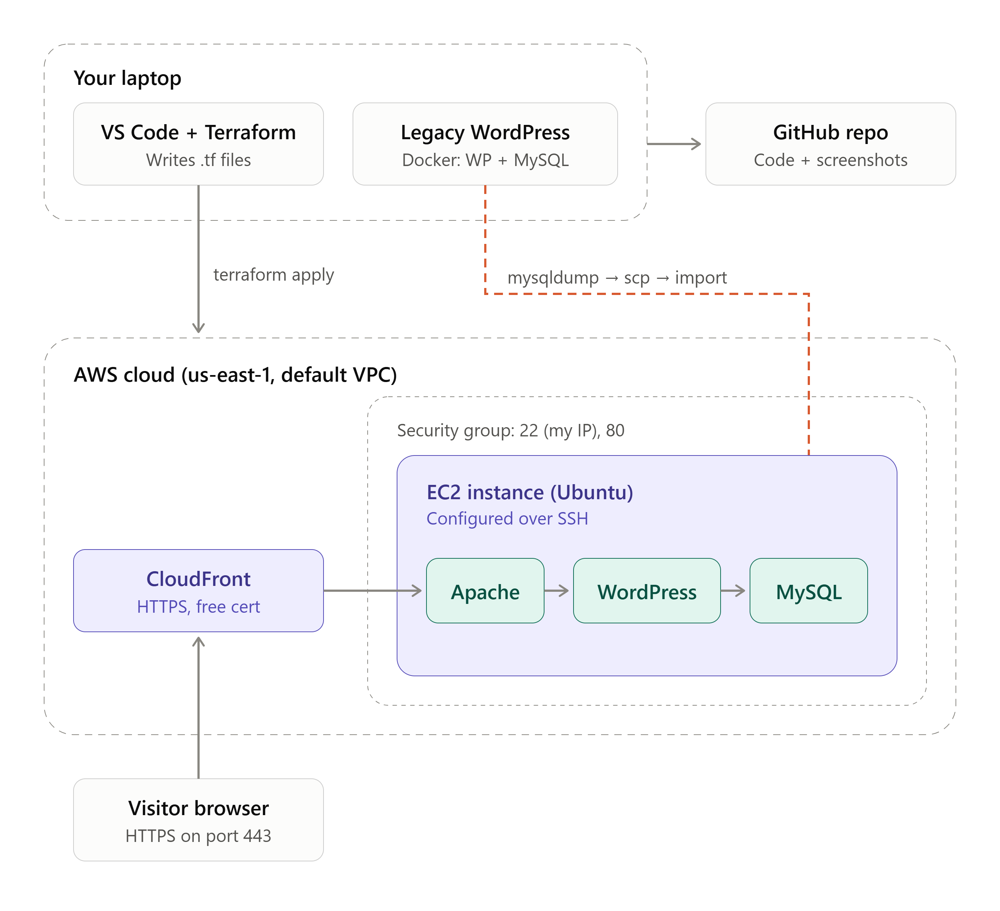

- **Build Path:** Local laptop running VS Code & Terraform provisioning AWS resources (`terraform apply`) while pushing repository commits to GitHub.
- **Data Path:** Local MySQL container running inside Docker migrated to EC2 via `mysqldump` -> `scp` -> MySQL import.
- **Traffic Path:** End-user browser connects via HTTPS on port 443 to Amazon CloudFront, proxying origin HTTP traffic over port 80 to Apache/WordPress/MySQL hosted on an Ubuntu EC2 instance within the default VPC.

---

## Unified Naming & Tagging Convention

All resources, components, and local configurations adhere strictly to the following project naming pattern:

`legacy-wp-[environment]-[component]`

- **AWS IAM Admin User:** `legacy-wp-dev-admin`
- **AWS EC2 Instance:** `legacy-wp-dev-ec2`
- **Security Group:** `legacy-wp-dev-sg` (SSH 22 restricted to administrative IP, HTTP 80)
- **SSH Key Pair:** `legacy-wp-dev-keypair` (`~/.ssh/legacy-wp-dev-key`)
- **CloudFront Distribution:** `legacy-wp-dev-cdn`
- **S3 State Bucket:** `legacy-wp-dev-tfstate-[account-id]`
- **Local Docker Containers:** `legacy-wp-local-wordpress`, `legacy-wp-local-mysql`
- **Standard Resource Tags:** `Project=legacy-wp`, `Environment=dev`, `ManagedBy=terraform`

---

## Implementation Log

### Phase 1: VS Code, Git & GitHub Setup
- Initialized public repository `aws-legacy-wordpress-ec2-cloudfront-migration`.
- Configured local WSL2 (Ubuntu) development environment on Windows 11 with VS Code and Git.
- Created directory hierarchy separating Terraform bootstrap code (`terraform/bootstrap`), main application infrastructure (`terraform/legacy-wp`), application files (`legacy-wordpress`), migration scripts (`scripts`), and documentation assets (`docs/screenshots`).
- Implemented a strict `.gitignore` policy to prevent tracking sensitive state artifacts (`.tfstate`), environment variables (`.env`), private key files (`*.pem`, `*.key`), database dumps (`*.sql`), and local media uploads (`wp-content/uploads/`).

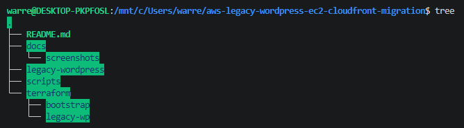

---

### Phase 2: Linux & AWS Foundations
- Configured AWS CLI with an administrative IAM user (`legacy-wp-dev-admin`) in region `us-east-1` (strictly adhering to root account isolation guidelines).
- Established an active AWS Budget ($5.00/month threshold) with email alerts to enforce financial governance and catch potential resource drift.
- Generated a 4096-bit RSA SSH key pair (`~/.ssh/legacy-wp-dev-key`) within the native WSL2 Linux filesystem, applying strict POSIX permissions (`chmod 400`) required for cryptographic SSH access.

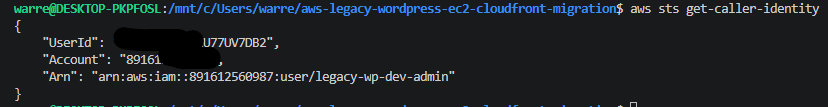
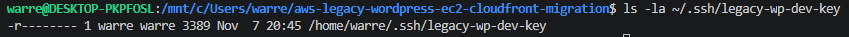

---

### Phase 3: Docker & Local Legacy WordPress Stack
- Built a multi-container local stack in `legacy-wordpress/` using Docker Compose, pinning exact container image tags (`wordpress:6.4-apache` and `mysql:8.0`) to avoid environment drift and ensure reproducible local builds.
- Enforced credential isolation by parameterizing container environment variables inside a `.env` file (excluded from version control) while committing a sanitized `.env.example` template for collaboration.
- Launched the local stack (`legacy-wp-local-wordpress` and `legacy-wp-local-mysql`) on port 8000 (`http://localhost:8000`), completed initial site installation, and populated real blog content and image uploads to prepare for migration.

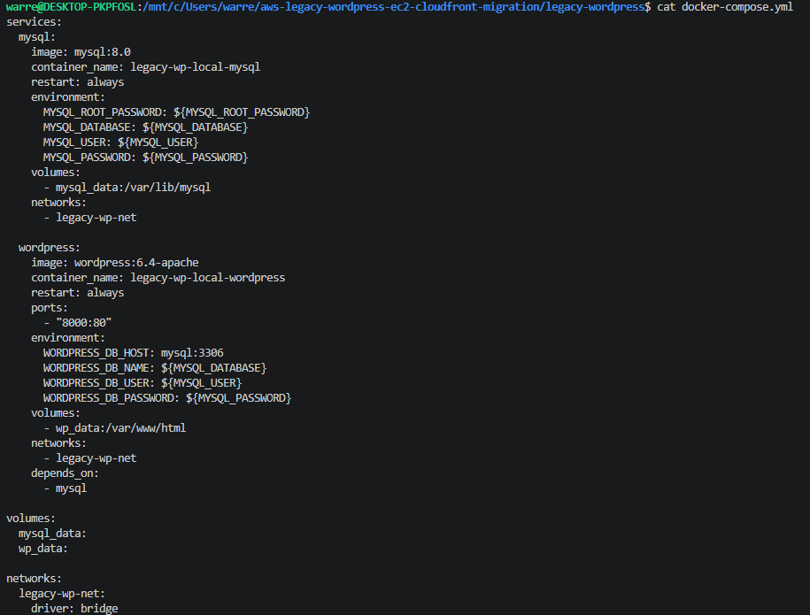
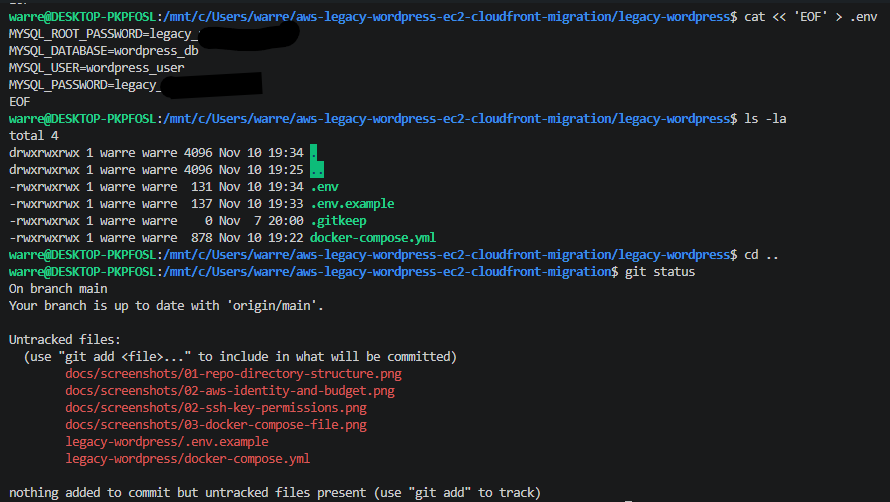
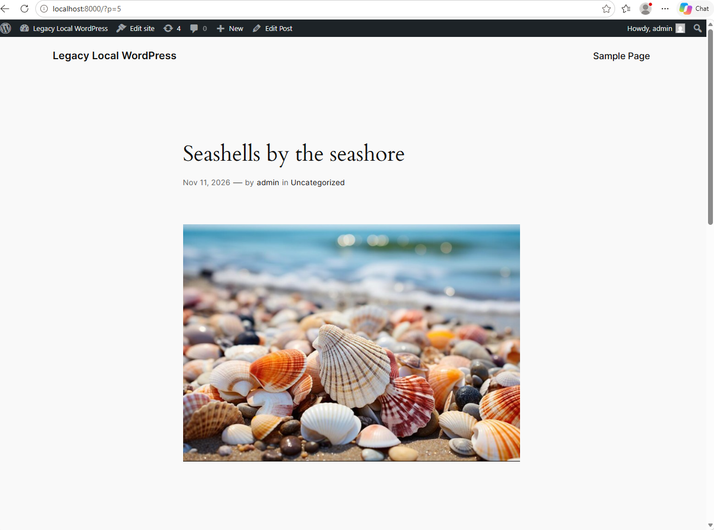

---

### Phase 4: Terraform Foundations & Cloud Infrastructure (Step 1: State Bootstrap)
- Provisioned a dedicated Amazon S3 remote state bucket (`legacy-wp-dev-tfstate-891612560987`) to decouple state storage from local developer machines.
- Enabled S3 bucket versioning for state recovery and strict public access blocks for security compliance.

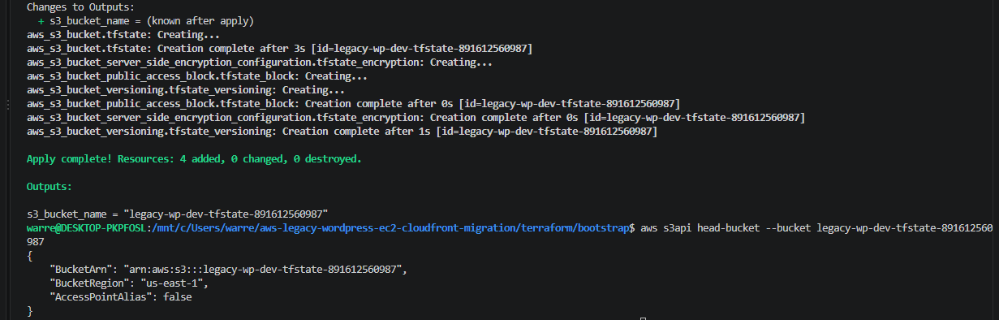
- Configured the main Terraform module (`terraform/legacy-wp/`) with an S3 remote backend (`legacy-wp-dev-tfstate-891612560987`) and native state locking (`use_lockfile = true`).
- Verified remote backend state initialization and provider constraints.

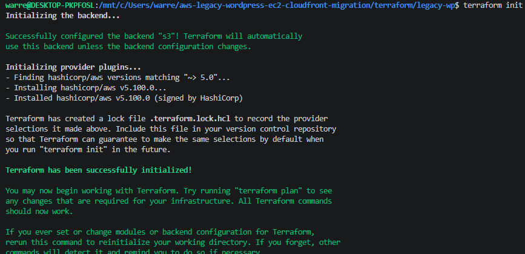
- Defined Terraform security group (`legacy-wp-dev-sg`) allowing SSH (port 22) and HTTP (port 80) alongside unrestricted egress.
- Configured AWS key pair resource (`legacy-wp-dev-keypair`) leveraging our local WSL2 public key (`~/.ssh/legacy-wp-dev-key.pub`).

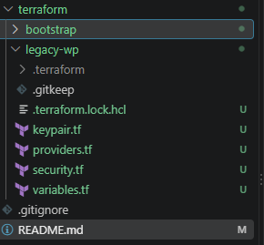
- Provisioned infrastructure resources via Terraform: `aws_key_pair`, `aws_security_group` (`legacy-wp-dev-sg`), and an `aws_instance` (`legacy-wp-dev-ec2`) running Ubuntu 22.04 LTS on an encrypted 8GB gp3 root volume.
- Verified successful cloud provisioning and captured public IP output.

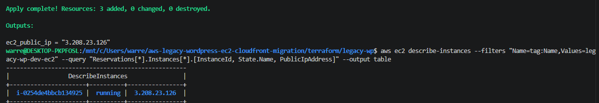

---

### Phase 5: Remote Server Configuration (Step 1: SSH Connectivity)
- Enforced strict private key permissions (`chmod 400`) on the local WSL2 filesystem (`~/.ssh/legacy-wp-dev-key`).
- Established secure remote administrative access over SSH to the Ubuntu 22.04 LTS EC2 instance (`3.208.23.126`).

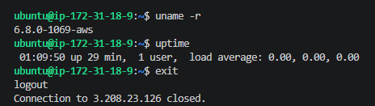

### Phase 5: Remote Server Configuration (Step 2: Docker Runtime Setup)
- Configured official Docker GPG keys and stable repositories on the Ubuntu 22.04 LTS remote host.
- Installed Docker Engine, containerd, and the Docker Compose plugin, and granted user privileges to run container commands.
- Verified runtime installation (`docker --version` and `docker compose version`).

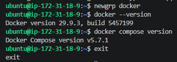

---

### Phase 6: Data Migration & Cloud Deployment (Step 1: Local Database Export)
- Extracted a full database snapshot (`db_backup.sql`) from the local `legacy-wp-local-mysql` container using `mysqldump` with `--no-tablespaces`.
- Verified export integrity, non-zero file size, and schema structure prior to cloud transfer.

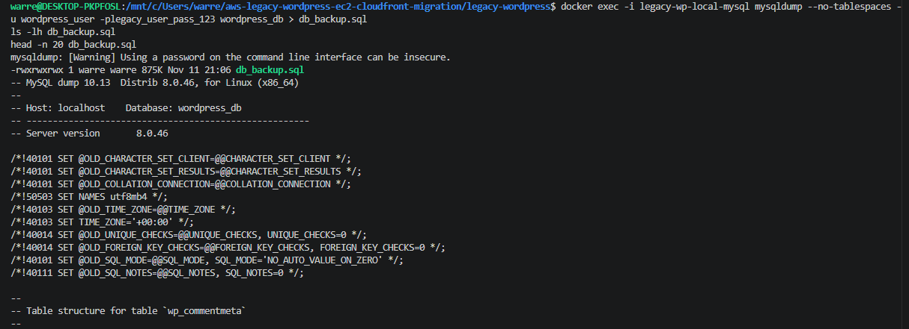

### Phase 6: Data Migration & Cloud Deployment (Step 2: Secure Data Transfer)
- Securely transferred the local database backup (`db_backup.sql`) to the remote EC2 host using `scp`.
- Verified file presence and integrity inside the remote `~/legacy-wordpress/` directory.

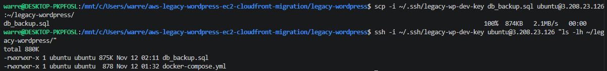

### Phase 6: Data Migration & Cloud Deployment (Step 3: Remote Stack Launch & DB Import)
- Launched the containerized WordPress and MySQL stack on the remote EC2 host using `docker compose up -d`.
- Imported the migrated SQL database snapshot (`db_backup.sql`) into the remote MySQL container.
- Verified database table creation and container runtime health.

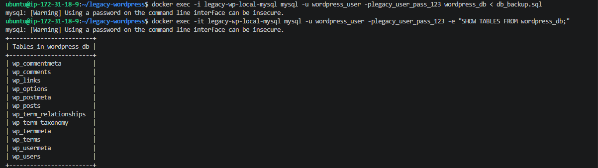

### Phase 6: Data Migration & Cloud Deployment (Step 4: Live Application Verification)
- Verified live HTTP accessibility of the migrated WordPress application via the EC2 instance (`http://localhost:8000`).
- Confirmed database connectivity, asset loading, and successful container rehost migration.

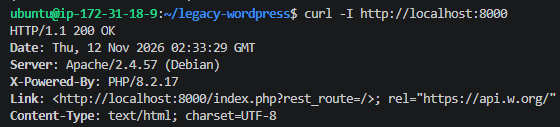

---

### Phase 7: Amazon CloudFront CDN & HTTPS Termination (Step 1: Provision CloudFront Distribution)
- Provisioned Amazon CloudFront distribution (`legacy-wp-dev-cdn`) via Terraform configured with an EC2 public DNS origin (`ec2-3-208-23-126.compute-1.amazonaws.com`).
- Configured viewer protocol policy to redirect HTTP to HTTPS and enabled global edge caching behaviors with full header/cookie forwarding.

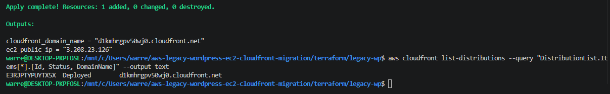

### Phase 7: Amazon CloudFront CDN & HTTPS Termination (Step 2: Configure Cache Behaviors)
- Configured ordered cache behaviors in Terraform to bypass edge caching for `/wp-admin/*` and `/wp-login.php`, ensuring authenticated session and backend form integrity.
- Maintained standard default caching rules for static site assets while forcing secure HTTPS viewer protocol policies.

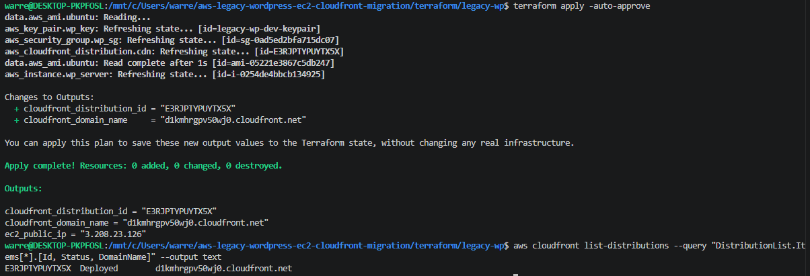

### Phase 7: Amazon CloudFront CDN & HTTPS Termination (Step 3: Update `wp-config.php`)
- Injected `X-Forwarded-Proto` proxy header check into `wp-config.php` to correctly detect Edge HTTPS termination from CloudFront and prevent infinite redirect loops.
- Explicitly defined `WP_HOME` and `WP_SITEURL` to `https://d1kmhrgpv50wj0.cloudfront.net` to ensure all core application links resolve through the CDN domain rather than the raw EC2 origin.

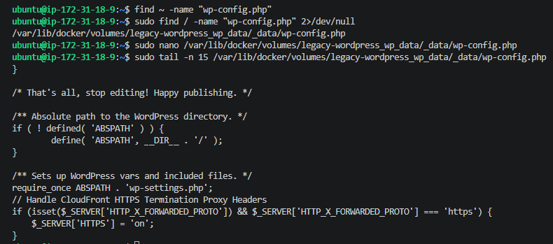

### Phase 7: Amazon CloudFront CDN & HTTPS Termination (Step 4: End-to-End Verification)
- Verified edge-to-origin connectivity and HTTPS redirection through CloudFront (`d1kmhrgpv50wj0.cloudfront.net`), ensuring secure content delivery without mixed-content errors or redirect loops.

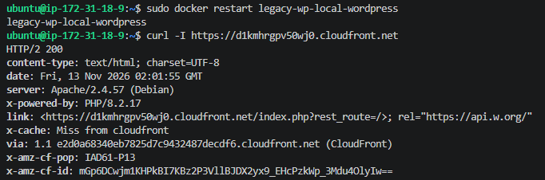

---

### Phase 8: Security Hardening, Automated Backups & Disaster Recovery

#### Step 1: Lock Down EC2 Security Group to CloudFront
- Updated Terraform security group rules (`legacy-wp-dev-sg`) to remove open internet HTTP access (`0.0.0.0/0`), restricting inbound traffic on port `8000` exclusively to the AWS CloudFront Managed Prefix List (`pl-58a01131`).
- Enforced that all incoming web traffic must pass through the CloudFront edge rather than hitting the origin directly.

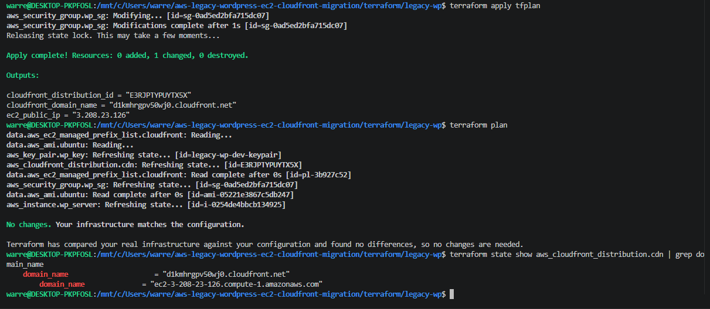

#### Step 2: Transition from SSH to AWS SSM Session Manager
- Removed Port 22 (`SSH from Admin IP`) entirely from the EC2 security group, eliminating public attack vectors and static private key management.
- Validated secure, audited remote management via AWS Systems Manager (SSM) Session Manager over internal AWS APIs.

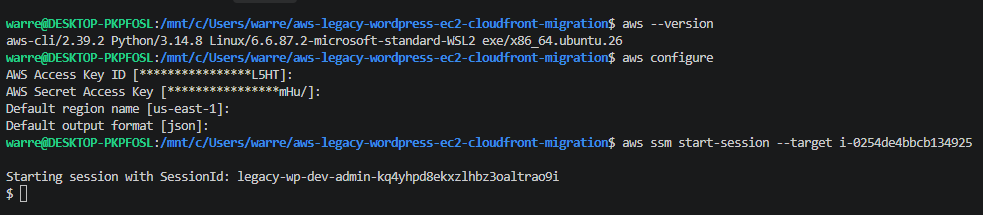

#### Step 3: Container-Aware Backup Script & Encrypted S3 Integration
- Developed a automated backup script (`/usr/local/bin/legacy-wp-backup.sh`) that executes container-aware database dumps (`mysqldump`) for MySQL (`legacy-wp-local-mysql`) and compresses WordPress user content (`wp-content`) into secure tarballs.
- Configured secure synchronization to an encrypted AWS S3 backup bucket (`legacy-wp-dev-backups-891612560987`).

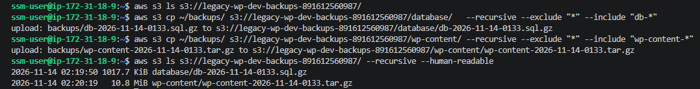

#### Step 4: Cron Automation & Log Verification
- Configured automated daily backup execution via root cron (`2 3 * * * /usr/local/bin/legacy-wp-backup.sh`), ensuring hands-free, reliable operational rotation.
- Inspected scheduled task logs (`/var/log/legacy-wp-backup.log`) to verify execution success and error handling.

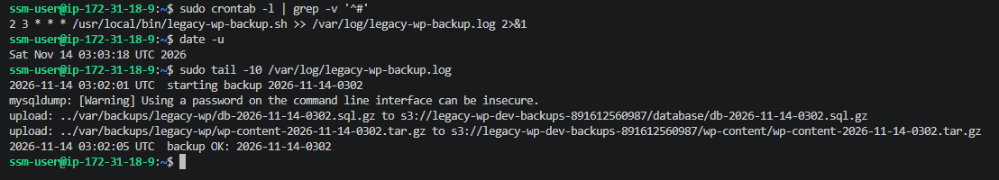

#### Step 5: Disaster Recovery Restore Test & Resource Verification
- Downloaded the latest encrypted backup archive from S3 into an isolated test environment and provisioned a low-memory MySQL recovery container (`legacy-wp-restore-test`) optimized with `performance-schema=OFF` and a `64M` buffer pool.
- Successfully verified complete WordPress schema integrity (12 tables, 9 posts/revisions, and active `admin` user account preservation).
- **Cleanup & Resource Hygiene:** Removed temporary test containers, cleared staging files from `/tmp`, verified via `docker ps` that only primary production containers remain active, and confirmed system memory recovery via `free -h` (restoring available RAM to `496 MiB` alongside normal swap utilization)[cite: 3, 4].

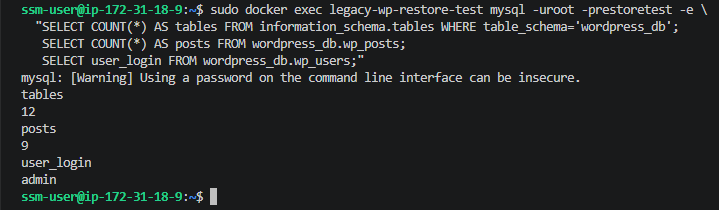
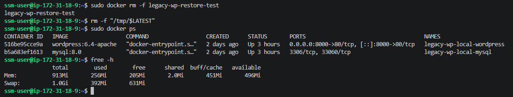

---

---

### Phase 9: Architectural Trade-offs & Future Evolution

#### Step 1: Architectural Comparison (Rehost vs. Refactor)
- **Current Rehost (Lift-and-Shift):** Migrated our containerized WordPress application to a single AWS EC2 instance using Terraform, CloudFront HTTPS termination, and automated S3 backups.
  - *Pros:* Rapid deployment timeline, guaranteed runtime consistency via Docker, and low baseline cost for single-server workloads.
  - *Cons:* Single Point of Failure (SPOF) and manual vertical scaling requirements.
- **Cloud-Native Refactor (Target Architecture):** Re-architecting the application into decoupled, managed cloud services (ECS/Fargate, RDS Multi-AZ, EFS, and ElastiCache).
  - *Pros:* High availability, multi-AZ fault tolerance, and elastic horizontal scaling.
  - *Cons:* Significantly higher architectural complexity, steeper learning curve, and increased baseline AWS costs.

#### Step 2: Next-Gen Target Architecture Blueprint (High Availability)
To evolve this project into an enterprise-grade production environment, we designed a fault-tolerant multi-AZ cloud blueprint:

```text
[ Route 53 (DNS) ] 
       │
       ▼
[ Amazon CloudFront (CDN & Edge Caching) ]
       │
       ▼
[ Application Load Balancer (ALB) (Multi-AZ Public Subnets) ]
       │
       ├──► [ Amazon ECS / Fargate Cluster (Private Subnets - Auto Scaling) ]
       │           │
       │           ├──► WordPress Container 1 (Read/Write)
       │           └──► WordPress Container 2 (Read/Write)
       │
       ├──► [ Amazon EFS (Elastic File System) ] (Shared wp-content/uploads)
       │
       ├──► [ Amazon RDS MySQL (Multi-AZ Managed Database) ] (Primary + Standby)
       │
       └──► [ Amazon ElastiCache (Redis) ] (Object Caching & Session Store)